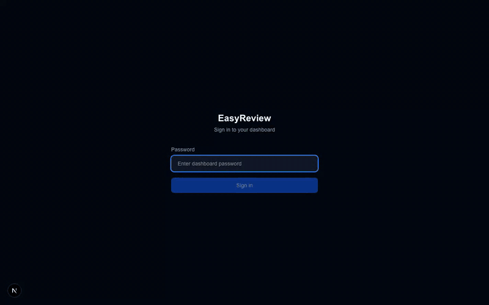

# EasyReview

<p align="center">
  
</p>

SMS review automation for local businesses. EasyReview pulls recent customers from QuickBooks Online and texts each one a review request through Twilio, once, with opt-out handling and a daily cap. A dashboard shows every run, every message, and lets the shop pause automation or edit the message copy.

**The pitch:** you close a work order in QuickBooks, and your customer gets a review text the same day. No new software to learn.

## How it works

```
Scheduler in the server process (9, 11, 13, 15, 17 shop time)
        │
        ▼
lib/schedule.ts ──► lib/batch.ts ──► QuickBooks: invoices from last N days
                         │
                         ├─► skip: already texted, opted out, invalid phone, over cap
                         └─► Twilio SMS ──► customer
        │
        ▼
SQLite (data/easyreview.db): runs, customers, opt_outs, message_attempts, settings
        │
        ▼
Dashboard (/): stats, run history, customer log, message editor, Run Now
```

- **Stack:** Next.js 16 (App Router), TypeScript, Tailwind v4, Node 24 built-in SQLite (`node:sqlite`), Twilio, QuickBooks Online API
- **Hosting:** runs on the shop's own Windows PC, reached over Tailscale. Setup guide: `docs/SHOP_PC_SETUP.md`
- **Single tenant:** one PC and one database file per shop
- **Auth:** dashboard is tailnet-only (`TAILNET_ONLY`) plus a password with signed HttpOnly cookies; `/api/cron` and `/api/health` take a bearer secret; the Twilio webhook is signature-validated
- **Alerts:** texts `ALERT_PHONE` when a run fails or QuickBooks disconnects (once per outage)
- **Backups:** daily `VACUUM INTO` copy in `data/backups/`, 14 days kept

## Quick start (local dev)

```bash
git clone https://github.com/alyananwar/EasyReview.git
cd EasyReview
npm install
cp .env.example .env.local   # fill in values, see the comments in the file
npm run dev                   # http://localhost:3000
```

Needs Node 24+. The database file is created automatically on first use. The scheduler stays off in `npm run dev` unless `SCHEDULER_ENABLED=true`. Twilio and Intuit account setup is in `docs/SETUP_ACCOUNTS.md`.

### Verify your setup

```bash
npm run verify
```

Checks every env var, that the QuickBooks redirect URI matches `PUBLIC_URL`, and that the Twilio credentials and number work.

## Commands

| Command          | What it does                              |
| ---------------- | ----------------------------------------- |
| `npm run dev`    | Dev server at localhost:3000              |
| `npm run build`  | Production build                          |
| `npm test`       | Run the Vitest suite                      |
| `npm run lint`   | ESLint                                    |
| `npm run verify` | Check `.env.local` and Twilio credentials |

## Project layout

```
app/
  page.tsx            Dashboard (client component)
  _components/        Dashboard sections (setup, message editor, send, tables)
  login/              Password login page
  privacy/ terms/     Public legal pages (required for A2P 10DLC)
  api/
    auth/             Dashboard login/logout + QuickBooks OAuth
    cron/             Manual trigger for the scheduled run (bearer secret, used over SSH)
    send-texts/       Manual "Run Now" trigger
    preview/          Dry-run: who would get texted, sample message
    runs/, customers/, opt-outs/, settings/   Dashboard data
    twilio/webhook/   Incoming SMS (STOP replies), signature-validated
    health/           Deployment health check (session or CRON_SECRET bearer)
instrumentation.ts    Starts the scheduler when the server boots
lib/
  db.ts               SQLite schema, helpers, daily backup
  schedule.ts         Run hours, quiet hours, scheduler loop
  batch.ts            Core send loop: dedupe, caps, jitter, retext window, alerts
  message.ts          Template rendering + validation (editable from dashboard)
  quickbooks.ts       QB OAuth tokens + invoice/customer queries
  sms.ts              Twilio sender
  phone.ts            US phone normalization
  auth.ts             Signed session cookies
  preview.ts          Dry-run classification
proxy.ts              Route protection (tailnet guard, redirects to /login)
scripts/verify-setup.ts   Environment check (npm run verify)
scripts/windows/      Shop PC: install.ps1 (one time), run.ps1 (keeps it running), deploy.ps1
docs/                 Deployment, account setup, pricing, architecture
```

## Deploying

Full guide in `docs/SHOP_PC_SETUP.md`. After the one-time setup, shipping a change is:

```bash
git push
ssh shop-pc deploy
```

External approvals to start early (they take weeks, not hours):

- **Twilio A2P 10DLC** brand + campaign registration (1 to 3 weeks), required for US carrier delivery
- **Intuit production app** review (1 to 2 weeks); the sandbox works meanwhile

## Compliance notes

- Every message ends with opt-out language; the renderer appends "Reply STOP to opt out." if the template doesn't include it
- STOP replies are recorded via the Twilio webhook (and from Twilio error 21610) and checked before every send
- Customers are texted at most once per `RETEXT_DAYS` (default 90)
- Quiet hours (default 8pm to 8am shop time) block scheduled sends
- `DAILY_CAP` (default 40) limits volume per run

## Docs

| Doc                                                               | Contents                                               |
| ----------------------------------------------------------------- | ------------------------------------------------------ |
| `docs/SHOP_PC_SETUP.md`                                           | Shop PC install, SSH, Tailscale, day-to-day commands   |
| `docs/SETUP_ACCOUNTS.md`                                          | Twilio, A2P 10DLC, and Intuit production app setup     |
| `docs/PRICING.md`                                                 | Pricing strategy ($49/mo Solo) and unit economics      |
| `docs/CONTEXT.md`, `docs/PLAN.md`, `docs/INNGEST_ARCHITECTURE.md` | Older Vercel + Supabase design notes, kept for history |
